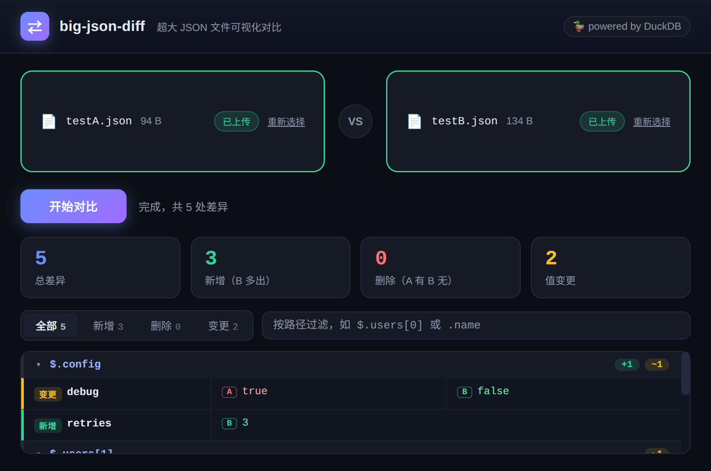

# big-json-diff

基于 **Node.js + TypeScript + DuckDB** 的超大 JSON 对比可视化工具。浏览器上传（或直接粘贴）两个 JSON 文件，服务端用 DuckDB 流式扁平化并计算差异，通过 WebSocket 实时推送，前端按路径分组渲染。实测 **2×32MB（各 204 万叶子节点）全量对比约 4 秒**。



## 特性

- **超大文件**：流式上传不落内存，DuckDB 分治扁平化，支持数百 MB 级 JSON
- **快**：小容器走 `json_tree` 一次展开，大容器落盘后由 DuckDB 流式 `read_json` 读取，两侧独立 DuckDB 实例并行处理
- **直观的差异视图**：按父路径分组、可折叠，变更值 A/B 双栏并排，新增/删除/变更三色标记，长值自动折叠
- **类型筛选 + 路径搜索**：百万级差异也能快速定位
- **两种输入方式**：拖拽/点选文件，或直接粘贴 JSON 文本
- **支持 npx**：`npx big-json-diff` 一键启动

## 快速开始

```bash
npm install
npm run dev        # 开发模式（tsx 直跑 TS）
# 或
npm run build && npm start
```

打开 <http://127.0.0.1:8420>，上传或粘贴两个 JSON 文件，点击「开始对比」。

### Node 版本要求

请使用 **Node 22 或 24**（仓库内已提供 `.nvmrc`，内容为 `24.21.0`）。原因是 `duckdb` 原生模块只为 Node 22（ABI `node-v127`）和 Node 24（ABI `node-v137`）发布预编译二进制：

- 在 Node 22 / 24 上，`npm install` 直接下载预编译包，无需编译器
- 在 Node 26（ABI `node-v147`）等较新版本上，预编译包返回 **404**，npm 会回退到用 `node-gyp` 从源码编译 DuckDB

Windows 上如果遇到下面的报错，就是这个原因，切换 Node 版本即可，**不需要安装 Visual Studio**：

```
[log] GET https://npm.duckdb.org/duckdb/duckdb-v1.4.4-node-v147-win32-x64.tar.gz
[error] install response status 404 Not Found
[warn] Pre-built binaries not installable for duckdb@1.4.4 and node@26.x (node-v147 ABI, unknown)
gyp ERR! find VS - missing any VC++ toolset
gyp ERR! stack Error: Could not find any Visual Studio installation to use
```

```bash
nvm install 24 && nvm use 24   # 或直接 nvm use（自动读取 .nvmrc）
node -v                        # 确认是 v22.x / v24.x
npm install
```

Linux / macOS 上通常不会碰到，因为系统 Node 多为 22/24，能直接命中预编译包。

### CLI 参数

```bash
big-json-diff [--port 8420] [--host 127.0.0.1]

  -p, --port   监听端口（默认 8420，环境变量 PORT 可覆盖）
  -H, --host   监听地址（默认 127.0.0.1，环境变量 HOST 可覆盖；设为 0.0.0.0 允许局域网访问）
  -h, --help   显示帮助
```

发布到 npm 后可直接 `npx big-json-diff -p 9000`。

## 工作原理

```
浏览器 ──HTTP 流式上传──▶ Node 服务 ──▶ 临时文件（workDir，每次对比独立目录）
浏览器 ◀──WebSocket 流式推送── DuckDB（内存库）
```

1. **扁平化**：每侧 JSON 在独立的 DuckDB `:memory:` 实例中展开为叶子表 `(path, value)`
   - 小容器（≤1MB）：lateral `json_tree` 一次展开整个子树（行级小文档极快）
   - 大容器（>1MB）：写入临时文件，用 DuckDB 流式 `read_json(format='array')` / `read_json_auto` 读回并按层展开，避免 DuckDB 行内大 JSON 函数的慢路径/内存问题
   - 叶子表经 parquet 交换回主库
2. **Diff**：`FULL OUTER JOIN` 叶子表，按 path 得到 `added / removed / changed`
3. **推送**：差异按路径排序分批（5000 行/批）经 WebSocket 带背压推送，前端分组懒渲染

路径形如 `$.users[12].address.city`，数组下标参与对比；对象键顺序不影响结果。

## 项目结构

```
src/cli.ts       CLI 入口（bin: big-json-diff）
src/server.ts    HTTP（静态页 + /upload）+ WebSocket（/ws，compare 协议）
src/diff.ts      DiffEngine：DuckDB 扁平化 / JOIN / 流式输出
public/index.html  单页 UI（无构建依赖）
```

## 说明与限制

- 对比粒度为叶子值；对象/数组整体新增时以 `{...}` / `[...]` 单条呈现
- 路径中对象键未转义，键名含 `.` 时展示可能存在歧义（两侧一致处理，不影响 diff 正确性）
- 超长叶子值推送前截断至 4000 字符
- 同一时间仅处理一个对比任务（防止大文件耗尽内存）
